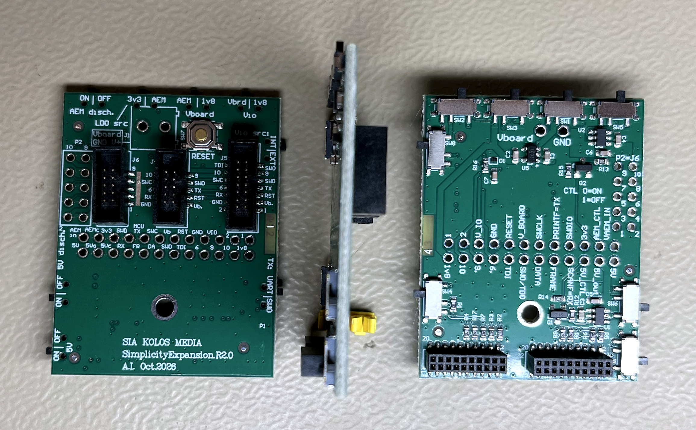
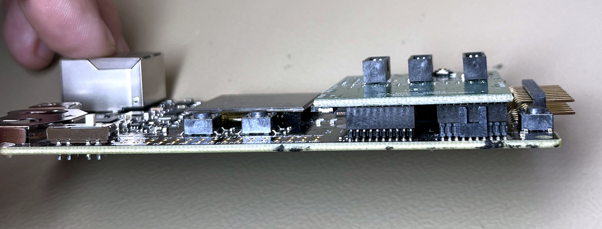
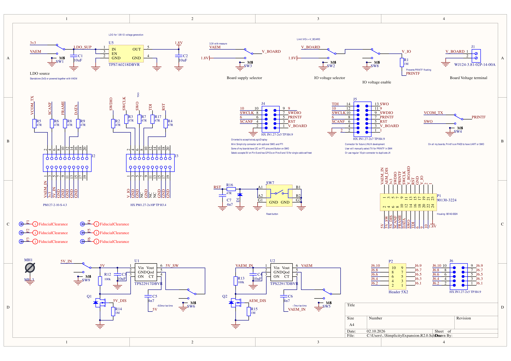
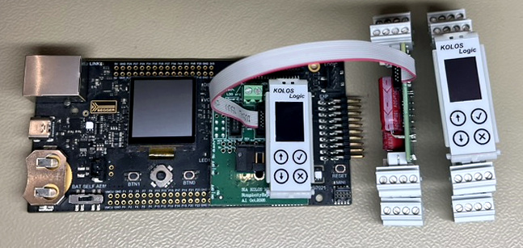
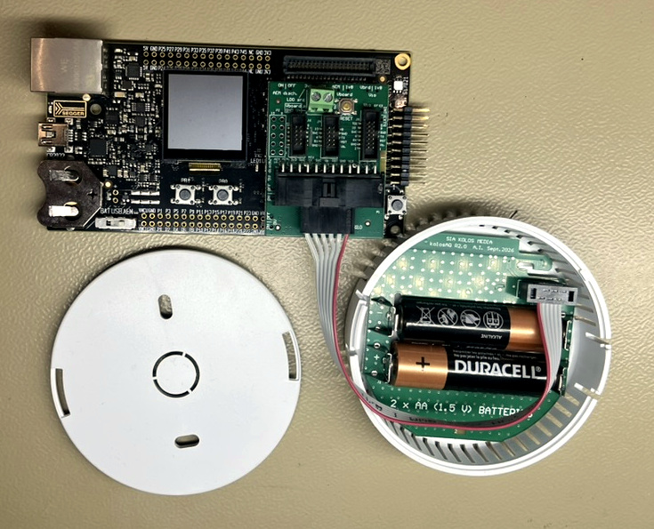
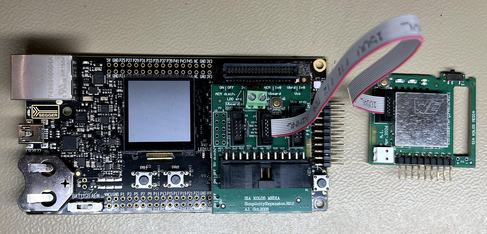

# SimplicityExpansion

SimplicityExpansion is a prototyping and debug adapter for Silicon Labs development kits. It brings power, programming, UART, and packet-trace signals from the kit's Simplicity and debug connectors out to accessible through-hole pads, with configurable target power and IO-reference voltages, for example, 3.3V board power, but 1.8V IO voltage. 

The main goal is to make as many useful signals as possible easy to reach. The breakout pads form **P1, a 2×12 array on a 2.54 mm pitch**. They can be used as test points, wired directly, or fitted with a compatible 2.54 mm through-hole connector. This makes the board useful for breadboard experiments, custom programming cables, and connecting a debugger to a prototype PCB.

This document describes **revision R2.0**. See the [schematic and PCB drawings](SimplicityExpansion.R2.0_manufacturing/SimplicityExpansion.R2.0.PDF) for the circuit and connector orientation.

## Board and mounting

| PCB views | Mounted on a development kit |
| --- | --- |
|  |  |

The PCB views show the target connectors and through-hole breakout on one side, the switches and other circuitry on the reverse, and the board's profile in between.

SimplicityExpansion plugs directly onto a compatible Silicon Labs development kit through **two compact 20-pin, 1.27 mm-pitch connectors**. The underside sockets, **J2 (Simplicity)** and **J3 (debug)**, mate with the kit's corresponding headers. This brings both interfaces onto the adapter without separate ribbon cables between the kit and the adapter. The side view shows the stacked arrangement; check connector alignment and pin-1 orientation before fitting the board.

## Capabilities

- Break out the Silicon Labs kit's debug, virtual COM port, power, and packet-trace signals to a 2.54 mm grid.
- Connect to a target through a Mini Simplicity-style connector or a custom cable.
- Select UART transmit or SWO for a shared target signal.
- Select the AEM supply or the onboard 1.8 V rail for target power, and select the debugger's IO reference independently.
- Interrupt the 5 V and AEM power paths under DUT GPIO control to test battery or supercapacitor backup operation.
- Assign a custom pinout to a 10-pin, 1.27 mm connector using wire links.
- Access all four JTAG signals for suitable targets, including Linux-based systems.

The board routes signals and selects the debugger's voltage reference; it does not provide separate level translators for every breakout signal.

## Schematic

[Open the full-resolution schematic](docs/images/schematic-r2.0.png) to zoom in on component values, pin numbers, and notes. This lossless image is rendered at 400 dpi from the R2.0 manufacturing PDF.

## Application examples

### Debugging with a display attached

A DIN-rail controller development setup with a KOLOS Logic display connected at the adapter and a ribbon cable leading to the target. The shared J4/J5 signals allow the display and its buttons to remain accessible while the target's programming connector is occupied by the debugger. In this application, custom nets `9` and `10` carry I²C, and net `6` carries a button signal.

### Indoor air-quality sensor: 3.3 V power, 1.8 V IO

This indoor air-quality sensor is supplied with **3.3 V**, while its sensors and IO operate at **1.8 V**. SimplicityExpansion supplies the debugger with a separate 1.8 V IO reference, allowing the debug signal levels to match the target's IO domain without reducing the board supply to 1.8 V.

The cable uses the **six adjacent P1 connections** for SWDIO, UART_TX/SWO, SWCLK, V_BOARD, RESET, and GND. This provides a compact programming and console connection without a bundle of crossing wires. The two AA batteries are visible in the open enclosure.

### LiSOCl₂ battery-manager development

A custom **lithium thionyl chloride (LiSOCl₂) battery-manager board** connected through a Mini Simplicity ribbon cable. Here, SimplicityExpansion serves as the adapter between the Silicon Labs development kit and the target, in place of Silicon Labs' conversion board. The photograph shows the direct Mini Simplicity connection; the additional breakout and configuration options remain available on the adapter.

## Connectors

| Connector | Purpose |
| --- | --- |
| **J1** | Two-position terminal for `V_BOARD` and GND. It is connected directly to the selected board-supply rail. |
| **J2** | 20-pin, 1.27 mm Simplicity interface: AEM power, auxiliary 3.3 V and 5 V, UART, and packet-trace signals. |
| **J3** | 20-pin, 1.27 mm debug interface: IO reference (`VTARGET`), SWD/JTAG signals, and reset. |
| **J4** | 10-pin, 1.27 mm Mini Simplicity-style target connector, with three application-specific positions. |
| **J5** | 14-pin, 1.27 mm connector sharing J4's main signals, with additional JTAG and configurable connections. |
| **P1** | Main 24-pad, 2.54 mm through-hole breakout. |
| **P2 + J6** | Custom cable adapter: each P2 pad connects directly to the same-numbered J6 pin. Wire links from P1 determine the pin assignment. |

### P1: main breakout

The following table lists electrical pin numbers, rather than a physical viewing orientation. Use the PCB markings and drawings to identify pin 1 before assembling a cable.

| Odd pin | Signal | Even pin | Signal |
| --- | --- | --- | --- |
| 1 | `VAEM_IN` — incoming AEM supply | 2 | `5V` — after SW9, before U1 |
| 3 | `AEM_DIS` — AEM power-disable input | 4 | `5V_SW` — switched 5 V output |
| 5 | `3v3` — auxiliary 3.3 V | 6 | `5V_DIS` — 5 V power-disable input |
| 7 | `SWDIO` / JTAG TMS | 8 | `SCANF` — target UART RX |
| 9 | `PRINTF` — target UART TX or SWO, selected by SW4 | 10 | `FRAME` — packet-trace frame |
| 11 | `SWCLK` / JTAG TCK | 12 | `DATA` — packet-trace data |
| 13 | `V_BOARD` — selected target supply | 14 | `SWO` / JTAG TDO |
| 15 | `RST` — active-low target reset | 16 | JTAG `TDI` |
| 17 | `GND` | 18 | Custom net `6` |
| 19 | `V_IO` — debugger IO reference | 20 | Custom net `9` |
| 21 | Custom net `2` | 22 | Custom net `10` |
| 23 | Custom net `1` | 24 | Onboard `1.8V` rail |

**Six common programming connections sit next to each other in one row:** P1 pins **7, 9, 11, 13, 15, and 17** carry **SWDIO, UART_TX/SWO, SWCLK, V_BOARD, RESET, and GND**, respectively. A six-conductor ribbon cable can be soldered directly to these adjacent pads, or connected through a single-row header, without crossing individual wires. This provides a compact connection to an external PCB.

`PRINTF` and `SCANF` are schematic net names: they mean target transmit and target receive, respectively. The usual target design connects **PA03 (Port A, pin 3)** to `PRINTF`, allowing the same wire to carry EUART transmit data or SWO on Silicon Labs devices that support those functions on PA03. Select the matching function in firmware and with SW4.

### J4 and J5: shared programming and application connections

J4 uses the first five Mini Simplicity signal positions. Positions 6, 9, and 10 are deliberately brought out as custom nets instead of being permanently assigned to SWO and packet trace.

| J4 pin | Signal | J5 pin | Signal |
| --- | --- | --- | --- |
| — | — | 1 | Custom net `1` |
| — | — | 2 | Custom net `2` |
| 1 | `V_BOARD` | 3 | `V_BOARD` |
| 2 | `GND` | 4 | `GND` |
| 3 | `RST` | 5 | `RST` |
| 4 | `SCANF` / target UART RX | 6 | `SCANF` / target UART RX |
| 5 | `PRINTF` / target UART TX or SWO | 7 | `PRINTF` / target UART TX or SWO |
| 6 | Custom net `6` | 8 | Custom net `6` |
| 7 | `SWDIO` / TMS | 9 | `SWDIO` / TMS |
| 8 | `SWCLK` / TCK | 10 | `SWCLK` / TCK |
| 9 | Custom net `9` | 11 | Custom net `9` |
| 10 | Custom net `10` | 12 | Custom net `10` |
| — | — | 13 | `SWO` / TDO |
| — | — | 14 | `TDI` |

The duplication is intentional. In the author's target designs, the programming connector is also used to connect a display: nets `9` and `10` carry I²C, and net `6` carries a button signal. With the debugger connected through this adapter to the target's programming connector, **J5 provides another connection for the display and button**. J4 and J5 share these nets electrically; the additional connector does not isolate them.

J5 also exposes **TMS, TCK, TDO, and TDI**, plus reset and five custom nets (`1`, `2`, `6`, `9`, and `10`). This allows a cable to be made for full four-signal JTAG debugging of a suitable target, including a Linux-based system. It is a custom connector assignment, so match the cable, voltage reference, and debugger configuration to the target. SW4 can remain in UART mode when a separate console TX connection is needed alongside JTAG.

### P2 and J6: freely assigned 10-pin connection

P2 is a 2.54 mm through-hole breakout of J6's 10 pins. **P2 pin n connects to J6 pin n**, with no predefined power or signal assignment. Solder wire links from P1 to P2 to create the required pinout on the 1.27 mm J6 connector. Include ground and the appropriate power or reference connection in the assignment.

## Switches

Switch functions below are described by the connected signals, avoiding left/right ambiguity when viewing opposite sides of the PCB.

| Switch | Function | Settings and effect |
| --- | --- | --- |
| **SW1** | **1.8 V LDO input source** (`LDO src`) | Selects auxiliary `3v3` or switched `VAEM` as the LDO input. `3v3` keeps the reference available independently of the AEM load switch; `VAEM` makes it follow that switched supply. |
| **SW2** | **IO-reference source** (`Vio`) | Selects `V_BOARD` or the onboard `1.8V` rail as the source for `V_IO`, through SW8. |
| **SW3** | **Target supply** (`Vboard`) | Connects `V_BOARD` to switched `VAEM` or the onboard `1.8V` rail. J1, P1, J4, and J5 expose this selected rail. |
| **SW4** | **UART/SWO selection** (`TX: UART/SWO`) | Routes the target's `PRINTF` wire to the debugger's virtual COM transmit path or its SWO/TDO path. |
| **SW5** | **AEM output discharge** (`AEM disch.`) | Enables or disconnects U2's quick-output-discharge path. When enabled, the switched `VAEM` output is discharged toward ground after U2 is disabled. This switch does not itself disable U2. |
| **SW6** | **5 V output discharge** (`5V disch.`) | Enables or disconnects U1's quick-output-discharge path for `5V_SW`. This switch does not itself disable U1. |
| **SW7** | **RESET** | Momentary pushbutton that pulls target reset low through a 47 Ω resistor. The reset circuit also includes a filter capacitor and an ESD-protection diode. |
| **SW8** | **IO-reference connection** (`Vio src: INT/EXT`) | In the internal setting, connects the SW2-selected source to `V_IO`. In the external setting, disconnects that source so a target-provided IO reference can be connected at P1 pin 19. The external setting does not generate a reference voltage. |
| **SW9** | **5 V input connection** (`5V ON/OFF`) | Connects or disconnects J2's 5 V supply from the local `5V` rail feeding U1. P1 pin 2 is downstream of SW9; P1 pin 4 is downstream of U1 as well. |

Choose `V_IO` to match the target's actual IO voltage. In particular, the independent 1.8 V setting can remain powered while `V_BOARD` is off; the switches do not automatically enforce `V_IO ≤ V_BOARD`.

## The onboard 1.8 V supply

U5 is a **TPS7A0218DBVR** in a common **SOT-23-5** package. Its typical quiescent current is only **25 nA**, making it attractive as a low-consumption **VTARGET/IO-reference source**.

For this board's intended use, treat the fitted regulator primarily as a reference supply. Its transient performance can be a limitation when powering a real target with abrupt or substantial load changes. Although the IC is rated for up to 200 mA under its specified conditions, that rating alone does not establish that the assembled board will meet a target's transient-voltage requirements.

If a robust 1.8 V target supply is needed, fit an LDO with suitable output-current and load-transient performance, usually at the cost of higher quiescent current. Check **pin compatibility**, dropout, thermal dissipation, and input/output capacitor requirements before replacing U5; sharing the SOT-23-5 package does not guarantee a drop-in replacement. Pin 4 of the fitted regulator is NC and is grounded on this PCB.

See the [TPS7A02 datasheet](https://www.ti.com/lit/ds/symlink/tps7a02.pdf) for the regulator's specifications.

## GPIO-controlled power-interruption tests

Two **TPS22917** load switches let the device under test (DUT) interrupt its own external supply through a GPIO and a wire back to this adapter:

| Power path | Load switch | GPIO connection on P1 | Control |
| --- | --- | --- | --- |
| `5V` → `5V_SW` | U1 | Pin 6, `5V_DIS` | High disables the output; low or disconnected normally enables it when input power is present. |
| `VAEM_IN` → `VAEM` | U2 | Pin 3, `AEM_DIS` | High disables the output; low or disconnected normally enables it when input power is present. |

Q1 and Q2 invert the disable signals before driving the load-switch enable inputs. The outputs have controlled startup ramps; the schematic indicates approximately **8.5 ms for 5 V** and **7 ms for AEM at about 3.3 V**.

This is useful for testing devices with batteries or supercapacitors: firmware can remove external power, check whether the backup source keeps the device operating, record the result, and restore external power. Repeated interruptions can also exercise power-fail detection and recovery logic.

A typical test is:

1. Power the DUT from `5V_SW`, or from `V_BOARD` with SW3 set to AEM.
2. Connect DUT ground to adapter ground, and a suitable DUT GPIO to the corresponding P1 disable input.
3. Set SW5 or SW6 for the required behavior: discharge enabled for a forced output discharge, or disconnected for a floating output after switch-off.
4. Drive the disable input high to remove the selected external supply. Observe the DUT's backup supply, firmware behavior, and current consumption.
5. Drive the input low to restore external power.

For backup-power tests, normally start with output discharge **disconnected**. If the DUT can feed its backup supply back onto the switched output, enabling discharge can drain that backup source through the adapter. Also account for alternate power paths through debug/UART signals or an independently powered IO reference. If the controlling GPIO loses power or returns to high impedance during the test, the adapter normally re-enables the supply; the power-off duration therefore depends on the DUT retaining control.

The AEM path includes the adapter's own load, including U5 when SW1 selects AEM. Consider that contribution when interpreting low-current measurements. The load-switch IC's 2 A rating is not a rating for the complete adapter, its connectors, or the development kit's supply.

See the [TPS22917 datasheet](https://www.ti.com/lit/ds/symlink/tps22917.pdf) for switching, discharge, and reverse-current behavior.

## Design and manufacturing files

- [Altium project](SimplicityExpansion.PrjPcb)
- [R2.0 schematic source](SimplicityExpansion.R2.0.SchDoc) and [PCB source](SimplicityExpansion.R2.0.CSPcbDoc)
- [R2.0 manufacturing package](SimplicityExpansion.R2.0_manufacturing/), including the schematic/PCB PDF, BOM, placement data, Gerbers, and STEP model
- [R1.0 manufacturing archive](SimplicityExpansion.R1.0/Outputs/), originally prepared for Aisler, including the PDF, BOM, placement data, Gerbers, drill files, STEP model, and ODB++ outputs. The operating instructions above describe R2.0; consult the archived drawings when using R1.0.
- [Silicon Labs AN958 reference guide](an958-mcu-stk-wstk-guide.pdf) for the development kit's debug and Simplicity interfaces

In the BOM, **Part Number** identifies the part chosen for European sourcing, while **Comment** identifies the alternative selected for JLCPCB assembly. Some entries use the same part for both. Verify the actual assembly selection and footprint when substituting parts.
